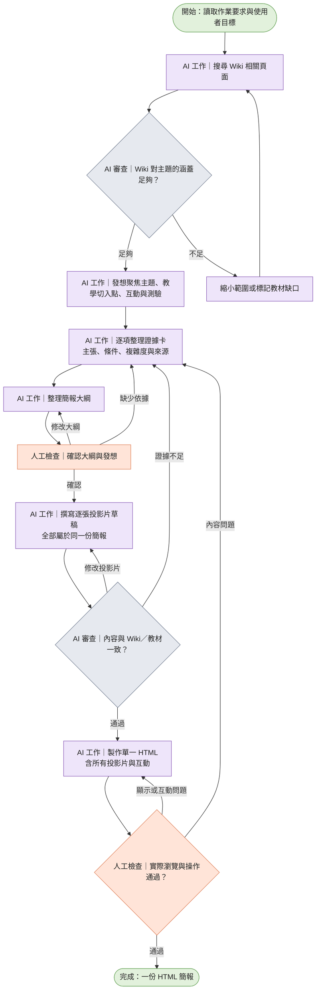

# 教學 HTML 簡報 Graph（v3）

## 目的與範圍

依作業要求與使用者目標，從五份已 ingest 的課堂教材中選出適合的教學主題，製作一份簡報。最終交付是一個單獨可開啟的 HTML 檔，所有投影片、互動和導覽都在同一份文件中；本流程不產生各章節的獨立 HTML。

## Graph

## 節點說明

1. **搜尋 Wiki（AI 工作）**：從 `wiki/index.md` 找出符合使用者目標的候選主題頁，再閱讀來源頁和相關主題頁。
2. **Wiki 覆蓋檢查（AI 審查）**：確認 Wiki 是否有足夠內容支持一份清楚的教學簡報。若候選範圍太大或資料不足，縮小主題／標出教材缺口後重新搜尋；不以外部搜尋補足。
3. **AI 發想（AI 工作）**：讀過可用 Wiki 內容後，提出適合聚焦的教學主題、切入點、類比、互動操作和小測驗構想。此時才選定本次簡報範圍；想法先視為草案，後續須逐項核對來源。
4. **證據卡（AI 工作）**：逐項整理教學主張、演算法條件、複雜度、Wiki 頁面及教材投影片定位。未有依據的點子予以刪除或標示缺口。
5. **大綱（AI 工作）**：把內容排成適合初學者的順序，例如問題背景、演算法步驟、互動練習和比較複習。
6. **人工確認（人工檢查）**：確認教學主題、順序及互動構想符合需求；不清楚處回到大綱修改，缺少依據則回到證據卡。
7. **逐張投影片草稿（AI 工作）**：依序寫每張投影片的標題、教學重點、簡潔文字、圖示／互動構想、小測驗和來源標示。草稿是內容規劃，所有投影片最後仍會放在單一 HTML。
8. **內容與來源核對（AI 審查）**：逐張核對主張、演算法步驟、複雜度、適用條件與來源是否吻合。錯誤回到草稿修正；來源不足回到證據卡。
9. **製作單一 HTML（AI 工作）**：將通過核對的草稿實作為一份 HTML，包含投影片、內部導覽、互動程式及樣式。
10. **瀏覽與操作檢查（人工檢查）**：實際開啟 HTML，檢查文字和圖示是否清楚、導覽是否可用、互動步驟及小測驗結果是否正確。顯示或互動問題修正 HTML；內容問題回查證據卡。

## 顏色圖例

- 紫色：AI 工作，例如搜尋、發想、整理、撰寫與製作。
- 灰色：AI 審查，例如 Wiki 範圍及內容來源核對。
- 橘色：人工檢查，例如確認大綱和實際瀏覽互動。
- 綠色：流程起點與完成交付。

## 版本規則

本資料夾保存 graph 流程與各階段的工作文件。任何文件修訂都建立下一版，不覆蓋舊版：`workflow-v1.md`、`workflow-v2.md`；其他文件同理，例如 `evidence-cards-v1.md`、`evidence-cards-v2.md`。新增版本時保留先前版本供比較。`assignment/run-log.md` 追加記錄每次實際執行使用的文件版本及檢查結果，不預先填造執行紀錄。

## 流程文件

- `ideation-vN.md`：AI 提出的教學切入點、互動與測驗構想。
- `evidence-cards-vN.md`：主張及其 Wiki／教材來源對照。
- `outline-vN.md`：投影片順序與教學目標。
- `slide-draft-vN.md`：逐張投影片的文字、圖像、互動及來源草稿；不是 HTML 成品。
- `workflow-vN.md`：graph 本身及節點說明。

以上階段文件在流程實際執行時建立；目前只建立 graph v1，不先填入未完成的發想、證據卡或草稿。

