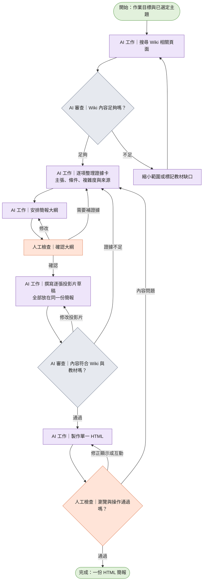

# 教學 HTML 簡報 Graph（v4，最終版）

## 目的與範圍

依作業要求和使用者選定的主題，使用五份已 ingest 的課堂教材製作一份教學簡報。最終交付是一個單獨可開啟的 HTML 檔，所有投影片、互動和導覽都在同一份文件中；不產生各章節的獨立 HTML。

## Graph

## 節點說明

1. **開始**：依作業要求和使用者選定的主題開始規劃。
2. **搜尋 Wiki（AI 工作）**：從 `wiki/index.md` 找出相關頁面，再閱讀主題頁與來源頁。
3. **內容足夠檢查（AI 審查）**：確認 Wiki 是否涵蓋所選主題。若不足，縮小簡報範圍或標記教材缺口後重查；不以外部資料補足。
4. **證據卡（AI 工作）**：逐項整理每個主張、演算法條件、複雜度、Wiki 頁面和教材投影片位置。無來源支持的內容不納入簡報。
5. **安排大綱（AI 工作）**：依初學者理解順序安排投影片，例如問題背景、演算法步驟、互動練習和比較複習。
6. **確認大綱（人工檢查）**：確認主題範圍和教學順序；需修改時回到大綱，缺少依據時回到證據卡。
7. **逐張草稿（AI 工作）**：依序規劃每張投影片的標題、教學重點、簡潔文字、圖示／互動、小測驗和來源。草稿不是獨立簡報檔，所有頁面最後放入同一份 HTML。
8. **內容與來源核對（AI 審查）**：檢查主張、演算法步驟、複雜度、適用條件及來源是否吻合。文字表達問題回到草稿；來源不足回到證據卡。
9. **製作單一 HTML（AI 工作）**：將核對通過的草稿製作成一份含投影片、內部導覽、互動及樣式的 HTML。
10. **瀏覽與操作檢查（人工檢查）**：實際開啟 HTML，檢查可讀性、導覽、互動步驟和小測驗結果。顯示或操作問題回去修正 HTML；內容問題回到證據卡。

## 顏色圖例

- 紫色：AI 工作，包括搜尋、整理證據、排大綱、撰寫草稿與製作 HTML。
- 灰色：AI 審查，包括 Wiki 範圍檢查和內容來源核對。
- 橘色：人工檢查，包括確認大綱與實際瀏覽操作。
- 綠色：流程開始與完成交付。

## 版本規則

本資料夾保存 graph 和各階段工作文件。先前版本保留，不覆蓋；修改時建立下一版，例如 `workflow-v5.md`、`evidence-cards-v2.md`。`assignment/run-log.md` 追加記錄實際執行使用的文件版本、步驟、檢查結果與修正，不預先填造執行紀錄。

## 流程文件

- `workflow-vN.md`：graph 流程及節點說明。
- `evidence-cards-vN.md`：主張及其 Wiki／教材來源對照。
- `outline-vN.md`：投影片順序與教學目標。
- `slide-draft-vN.md`：逐張投影片的文字、圖像、互動及來源草稿；不是 HTML 成品。

階段文件在實際執行對應流程時建立。目前已建立 graph v1–v4；證據卡、大綱與逐頁草稿尚未建立。
